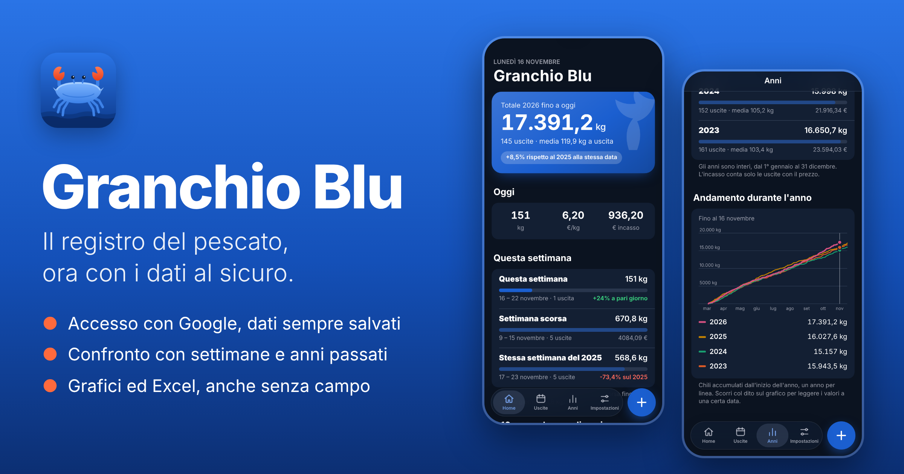
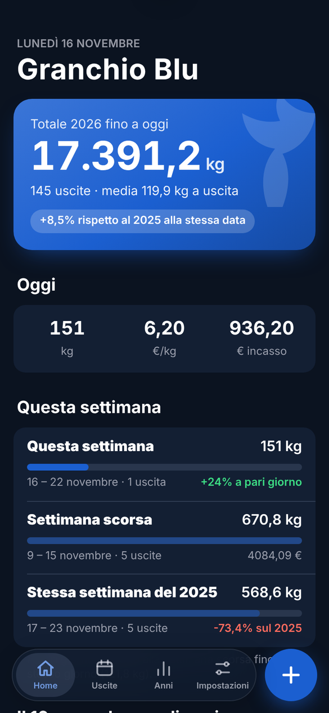
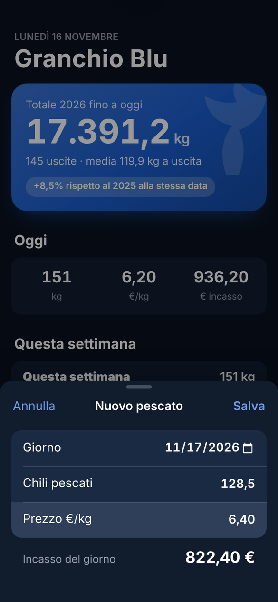
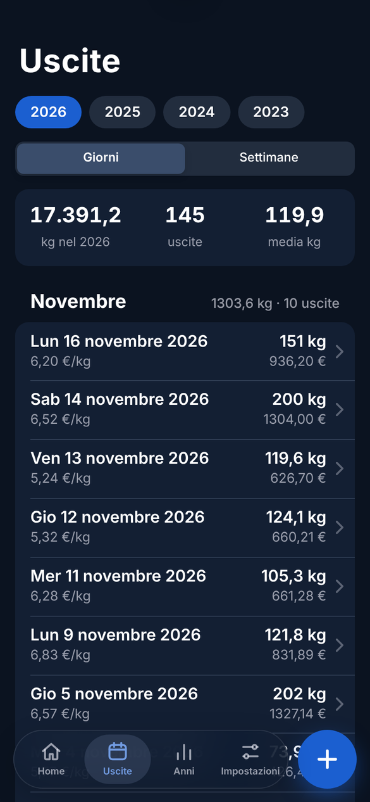
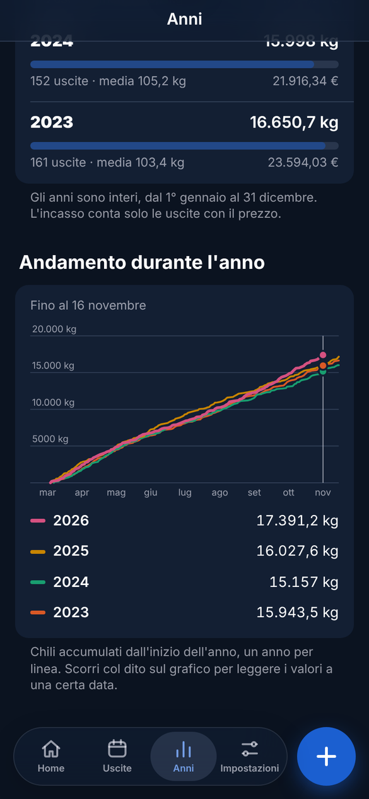
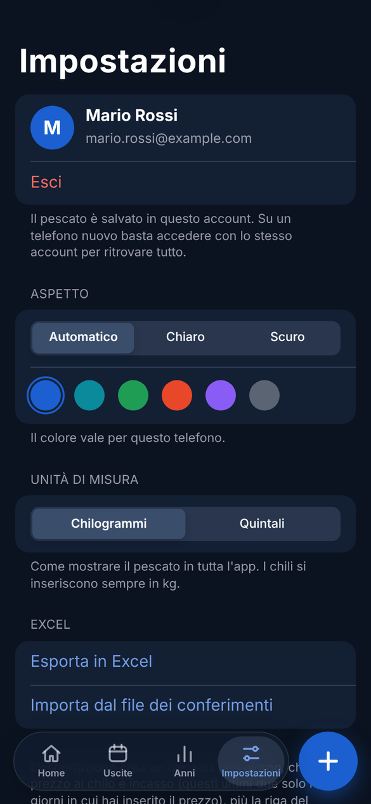

  

# 🦀 Granchio Blu · versione con accesso Google

**Granchio Blu** è una web app per tenere il registro del pescato di granchio blu: quanti chili si portano a terra ogni giorno, a che prezzo, e come va la stagione rispetto alle settimane e agli anni passati.

Questa versione aggiunge l'**accesso con Google**: il pescato viene salvato online nel proprio account, così **non si perde se il telefono si rompe** o si cambia, e ognuno (papà, amici) ha il suo registro privato.

È nata dalla versione 2.3 di [Granchio-Blu-App-Tracker](https://github.com/TheRealJayser/Granchio-Blu-App-Tracker), che resta com'era.

### 👉 [granchio-blu.web.app](https://granchio-blu.web.app)

È pensata per chi lavora in barca: si apre dall'icona sulla schermata Home come un'app normale, a tutto schermo, funziona anche senza campo e si usa con un pollice.

## ✨ Funzionalità

- 🔐 **Accesso con Google** – un tocco, nessuna password da ricordare. I dati sono privati: ognuno vede solo i suoi.
- ☁️ **Dati al sicuro** – il pescato è salvato online. Su un telefono nuovo basta accedere con lo stesso account per ritrovare tutto.
- 📶 **Funziona anche senza campo** – senza rete l'app si apre e si può inserire il pescato: i dati partono da soli appena torna la connessione.
- ➕ **Inserimento rapido** – il pulsante **+** apre un pannello con giorno, chili pescati e prezzo al chilo; l'incasso del giorno viene calcolato da solo.
- 🧾 **Più vendite nello stesso giorno** – se parte del pescato va a un prezzo e parte a un altro, si inseriscono come vendite separate: il giorno mostra il totale dei chili e dell'incasso.
- 📅 **Totale dell'anno** – i chili dal 1° gennaio a oggi, il numero di uscite, la media per uscita, l'incasso dell'anno con la media di guadagno a uscita e la differenza rispetto all'anno precedente alla stessa data.
- 📆 **Questa settimana** – la settimana in corso a confronto con quella scorsa e con la stessa settimana dell'anno prima, «a pari giorno».
- 🔁 **Lo stesso giorno negli anni** – il pescato di oggi messo a confronto con lo stesso giorno di ogni anno precedente.
- 🗂️ **Uscite** – elenco giorno per giorno diviso per mese (con chili, uscite e incasso di ogni mese), oppure settimana per settimana, con il riepilogo dell'anno: chili, uscite, incasso, media in € a uscita e prezzo medio al chilo.
- 📈 **Grafico degli anni** – i chili accumulati dall'inizio dell'anno, una linea per anno: si scorre col dito per leggere i valori.
- 📊 **Excel** – esporta un file `.xlsx` con giorno, chili, prezzo e incasso; importa il file dei conferimenti (legge tutte le righe tranne *VONGOLE* e *SEMINAVONGOLE*, e somma più righe nello stesso giorno).
- 🎨 **Grafica iOS e personalizzazione** – barra in basso a scorrimento, animazioni, tema automatico, chiaro o scuro e sei colori a scelta.
- ⚖️ **Chili o quintali** – l'unità di misura si sceglie nelle impostazioni.
- 🛡️ **Cancellazione protetta** – un giorno si cancella con due tocchi; per eliminare un mese, un anno o tutto serve scrivere `ELIMINA`.

Le novità di ogni aggiornamento sono in [CHANGELOG.md](CHANGELOG.md).

## 📱 Schermate

| Accesso | Home | Nuovo pescato | Uscite | Anni | Impostazioni |
|:---:|:---:|:---:|:---:|:---:|:---:|
|  |  |  |  |  |  |

Le schermate mostrano dati di esempio.

## 📲 Installazione

1. Apri [granchio-blu.web.app](https://granchio-blu.web.app) in **Safari** e premi **Accedi con Google**.
2. Su iPhone: **Condividi** → **Aggiungi alla schermata Home**. Su Android: menu ⋮ → **Installa app**.
3. Da quel momento apri l'app sempre dall'icona del granchio.

**Dalla vecchia app?** Nella vecchia: *Impostazioni → Backup → Copia*. Nella nuova: *Impostazioni → Backup → Ripristina*, incolla e premi **Importa**. Oppure importa di nuovo il file Excel dei conferimenti.

## 🔒 Dove finiscono i dati

I dati sono salvati online nell'**account Google** di chi usa l'app e li vede solo lui: ogni persona ha il suo archivio, separato dagli altri. Si possono usare più dispositivi con lo stesso account. Tema, colore e unità di misura restano invece sul singolo telefono.

## 🛠️ Com'è fatta

Nessun framework e nessuna compilazione: è un sito statico che usa Firebase (piano gratuito Spark, progetto `granchio-blu`).

| File | A cosa serve |
|---|---|
| `index.html` | Tutta l'app: interfaccia, calcoli, import/export |
| `sw.js` | Service worker: fa aprire l'app anche senza connessione |
| `manifest.webmanifest`, `icon-*.png` | Nome, colori e icone per la schermata Home |
| `firestore.rules` | Regole di sicurezza: ognuno legge e scrive solo i propri dati |
| `firebase.json`, `.firebaserc` | Configurazione di Firebase Hosting |
| `.github/workflows/deploy.yml` | Pubblica l'app a ogni modifica su `main` |
| `docs/` | Immagini di questo README |

- **Hosting:** Firebase Hosting su `granchio-blu.web.app`; l'accesso Google passa dallo stesso dominio, così funziona anche su iPhone.
- **Accesso:** Firebase Authentication con Google.
- **Dati:** Cloud Firestore (Milano, `europe-west8`), in `users/{uid}/uscite/{AAAA-MM-GG}`, un documento per giorno: `kg` è il totale, `p` il prezzo medio e, se nel giorno ci sono più vendite, `t` è l'elenco delle vendite (`[{kg, p}]`).
- **Pubblicazione:** ogni modifica caricata su `main` va online da sola con GitHub Actions, usando il segreto `FIREBASE_SERVICE_ACCOUNT_GRANCHIO_BLU`.
- Per leggere e scrivere Excel in import si usa [SheetJS](https://sheetjs.com/), caricata solo quando serve.

---

Fatta per mio padre, pescatore di granchio blu 🦀

